# 개발심의회 대시보드 사용 매뉴얼

사업포털 엑셀을 동기화해 안건을 자동으로 받아오고, PM·심의방법·일정 같은 팀 데이터는 여기서 직접 관리하는 내부 도구입니다. 아래 화면은 전부 실제로 눌러보며 찍은 스크린샷입니다.

- **대상**: 개발심의회 담당자 (1인 운영)
- **주소**: `http://localhost:4000`
- **데이터**: 서버의 `data/` 폴더에 저장

---

## 30초 요약

**평소에 하는 일은 이 3단계뿐입니다.**

1. **포털 데이터 업로드** 버튼(사업) 으로 사업포털 엑셀을 올린다
2. 새로 들어온 안건 중 우리 부문 것만 골라 **사업부문 지정** (그 외엔 "해당없음"으로, 즉 우리가 관리 안 해도 되는 사업으로 일괄 처리)
3. 우리 부문 안건에 **PM 배정**하고 진행시키기

> ⚠️ **처음 쓰는 거라면**: 첫 동기화 때는 몇백 건이 한꺼번에 "신규"로 뜹니다. 버그 아니고 정상이니 자세한 건 [8. 포털 데이터 업로드](#8-포털-데이터-업로드-가장-중요)를 먼저 보세요.

궁금한 게 이미 있다면 바로 [16. 자주 묻는 상황](#16-자주-묻는-상황)으로 가도 됩니다.

## 아이콘 한눈에 보기

화면 어디서나 같은 뜻으로 쓰입니다 — 여기서 한 번만 익히면 됩니다.

| 아이콘 | 뜻 |
|---|---|
| ✨ | 새로 동기화되어 아직 한 번도 안 열어본 안건 |
| 🗑 (휴지통) | **완전 삭제** — 되돌릴 수 없습니다. 확인 팝업이 한 번 더 뜹니다 |
| ↩ (복원) | 포털에서 사라져 자동으로 숨겨진 안건을 다시 보이게 되돌리기 (사람이 직접 삭제한 건 이 버튼으로 복원할 수 없습니다) |

---

## 목차

**① 화면 둘러보기**
1. [현황 요약](#1-현황-요약)
2. [표 보기](#2-표-보기)
3. [목록·상세 보기](#3-목록상세-보기)
4. [칸반 보드](#4-칸반-보드)
5. [일정](#5-일정)
6. [AI 어시스턴트](#6-ai-어시스턴트)

**② 실제로 하는 작업들**
7. [안건 수동 추가](#7-안건-수동-추가)
8. [포털 데이터 업로드](#8-포털-데이터-업로드-가장-중요)
9. [사업부문 분류](#9-사업부문-분류)
10. [사업형태 및 1차 분류](#10-사업형태-및-1차-분류)
11. [필터 활용](#11-필터-활용)
12. [변경 이력 · 되돌리기](#12-변경-이력--되돌리기)
13. [안건 삭제 · 포털 제외 복원](#13-안건-삭제--포털-제외-복원)
14. [엑셀 내보내기](#14-엑셀-내보내기)
17. [레거시 데이터(구 엑셀) 업로드](#17-레거시-데이터구-엑셀-업로드)

**③ 참고**
15. [데이터는 어디에 있나](#15-데이터는-어디에-있나)
16. [자주 묻는 상황](#16-자주-묻는-상황)

---

## 0. 전체 구조 한눈에

같은 데이터를 화면마다 다른 방식으로 보여줄 뿐, 어느 화면에서 고쳐도 즉시 다른 화면에 반영됩니다.

| 화면 | 이럴 때 쓴다 |
|---|---|
| 현황 요약 | 전체 진행 상태를 숫자·그래프로 훑어볼 때 |
| 표 보기 | 엑셀처럼 정렬·일괄 수정·내보내기 할 때 |
| 목록·상세 보기 | 안건 하나를 골라 자세히 들여다보고 댓글 남길 때 |
| 칸반 보드 | 단계별로 무엇이 어디에 몰려있는지 시각적으로 볼 때 |
| 일정 | 기한 기준으로 타임라인·달력으로 볼 때 |
| AI 어시스턴트 | 지금 필터링된 안건들에 대해 자연어로 물어볼 때 |

> 💡 어느 화면에서든 헤더의 **안건 검색 ⌘K**로 안건 이름을 바로 검색해 점프할 수 있습니다.

---

## 1. 현황 요약

맨 처음 열리는 화면입니다. 전체 건수, 결재완료 건수, 정체 안건, 단계별 분포, 최신 안건을 카드로 보여줍니다. 카드의 안건명을 클릭하면 바로 수정 모달이 열립니다.

아래 헤더 버튼 4개와 부문 탭·검색창은 **이 화면뿐 아니라 표 보기·칸반 보드·목록·상세 보기·일정, 어디서나 똑같이** 있습니다.

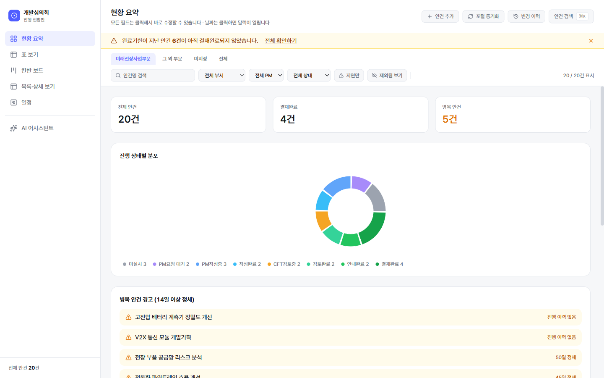

- **안건 추가** — 새 안건 수동 등록
- **포털 데이터 업로드** — 사업/국책사업 엑셀 업로드 (클릭하면 선택지가 뜸)
- **변경 이력** — 전체 수정 로그 + 되돌리기
- **안건 검색 ⌘K** — 이름으로 바로 점프
- **부문 탭** — 미래전장사업부문/그 외 부문/미지정/전체
- **안건명 검색창**

버튼을 누르면 살짝 눌리는 효과가 나서 클릭이 제대로 됐는지 바로 알 수 있습니다.

정체 안건 카드는 14일 이상 같은 단계에 머물러 있는 안건을 자동으로 뽑아 보여줍니다.

---

## 2. 표 보기

엑셀과 가장 비슷한 화면입니다. 열 제목을 클릭해 정렬하고, **행을 클릭하면 안건 상세 팝업이 뜹니다** — 수정은 그 팝업 안에서 합니다. 필요 없는 열은 **컬럼** 버튼으로 숨길 수 있습니다.

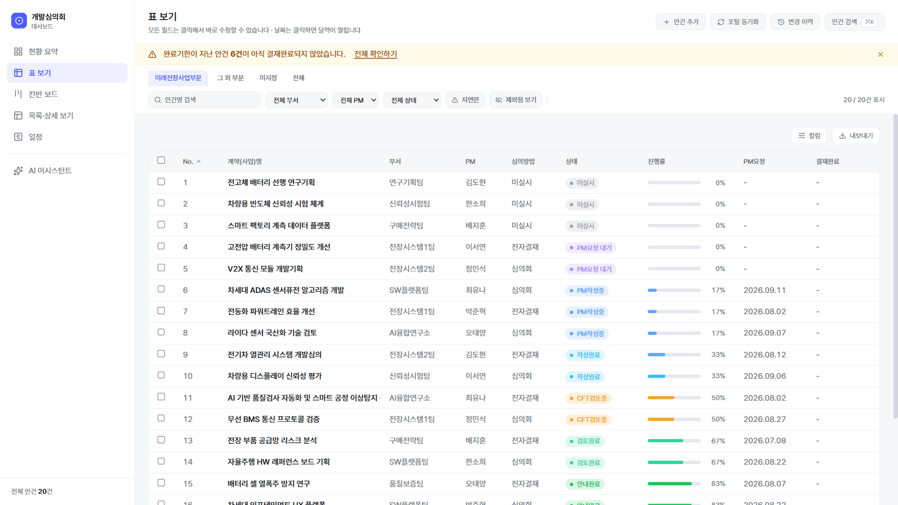

- 체크박스 — 여러 건 선택해 일괄 편집 (체크박스만 예외로, 눌러도 팝업은 안 뜹니다)
- 행 클릭 — 어디를 눌러도 상세 팝업 (컬럼을 뭘 숨겨뒀든 상관없음)
- **BM 이름 · BM 부서 · PM · PM 부서** — 네 열 모두 포털/팀 입력값을 각각 따로 보여줍니다 (BM 부서는 포털의 담당부서, PM 부서는 직접 입력)
- **계약금액(백만원)** — 천 단위 콤마가 자동으로 붙어 표시됩니다 (저장값 자체는 숫자 그대로)
- **컬럼** — 표시할 열 선택
- **내보내기** — 지금 필터 결과를 엑셀로

안건이 100건을 넘으면 페이지 이동 버튼이 나타나 수만 건이 들어와도 버벅이지 않습니다. 칸반 보드·일정도 컬럼(단계)당 150~200건까지만 표시하고 나머지는 검색·필터로 좁혀 보게 안내합니다.

### 여러 건 한꺼번에 수정하기 (일괄 편집)

체크박스로 여러 개를 고르고 **딱 한 번만** 값을 지정하면 고른 것 전체에 동시에 적용됩니다. 이 보라색 툴바는 선택한 상태로 표를 아래로 스크롤해도 화면 상단에 계속 붙어있습니다.

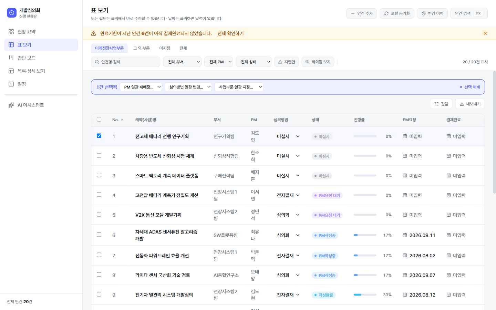

- PM 일괄 재배정
- 심의방법 일괄 변경
- 사업부문 일괄 지정 — 옛 사업 여러 건을 "해당없음"으로 한 번에
- **선택 삭제** — 체크한 건 전체를 **완전 삭제**합니다. 되돌릴 수 없으니 확인 팝업을 꼭 확인하세요 (자세한 내용은 [13. 안건 삭제 · 포털 제외 복원](#13-안건-삭제--포털-제외-복원))

---

## 3. 목록·상세 보기

왼쪽에서 안건을 고르면 오른쪽에 전체 필드, 진행 단계, 댓글창이 나타납니다. 안건 하나를 붙잡고 여러 필드를 순서대로 채워나갈 때 가장 편합니다.

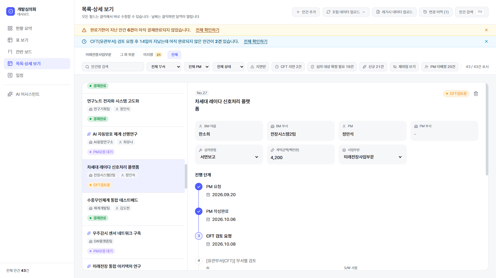

- 삭제 아이콘 (휴지통) — 완전 삭제, 복원 불가
- PM 필드 — 클릭해서 이름 입력
- 사업부문 드롭다운
- 진행 단계 날짜 — 클릭하면 달력
- 댓글 입력창 (`@이름`으로 멘션)

댓글에 `@이름`을 붙이면 자동으로 강조 표시됩니다. (계정·알림 없이 표기만 되는 기능입니다)

> ⚠️ **[유관부서(CFT)] 검토 단계는 부서 8개(AI/S·W시험/개발구매/개발품질/원가분석/M&S/체계공학/사업관리) 날짜가 전부 입력돼야 "검토완료"로 넘어갑니다.** 하나라도 비어있으면 "CFT검토중"에 그대로 머뭅니다 — 진행 단계 패널에서 8개를 한 번에 입력·확인할 수 있습니다.

> ✨ 새로 동기화된 안건을 한 번 열어보면 자동으로 "확인함" 처리되어 "신규" 필터에서 빠집니다.

---

## 4. 칸반 보드

단계별로 카드를 늘어놓고 어디에 안건이 몰려있는지 보는 화면입니다. 두 가지 축으로 바꿔볼 수 있습니다: **가로형 / 세로형** 배치, **세부단계 / 상위단계** 묶음.

| 가로형 · 세부단계 | 세로형 |
|---|---|
| 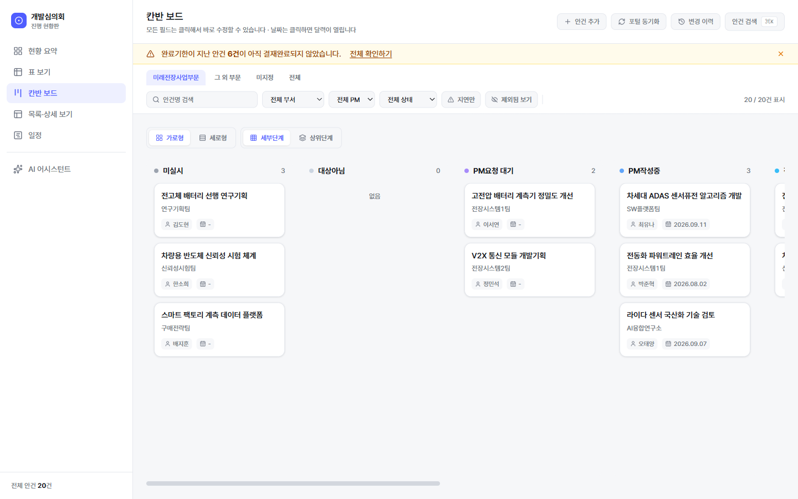 | 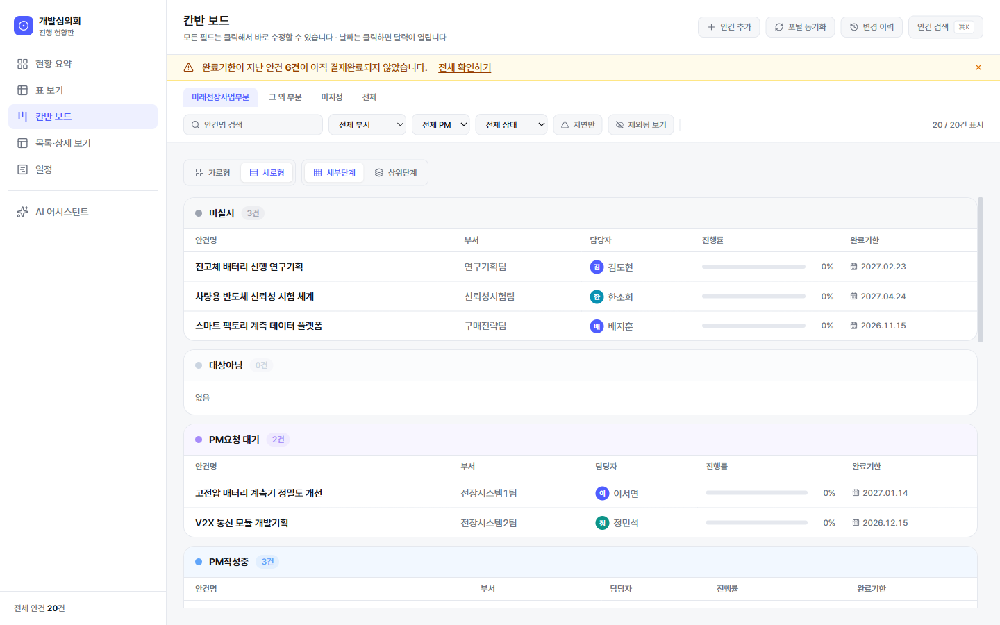 |

- 가로형 — 단계를 좌우로 나열 / 세로형 — 단계를 표처럼 세로로
- 세부단계 — 8단계 그대로 / 상위단계 — 3개 그룹으로 묶어서

상위단계로 바꾸면 [PM 작성 현황] · [유관부서(CFT) 검토 현황] · [안내&결재] 세 그룹으로 크게 묶여서 보입니다 — 세부 흐름보다 큰 그림이 필요할 때 씁니다.

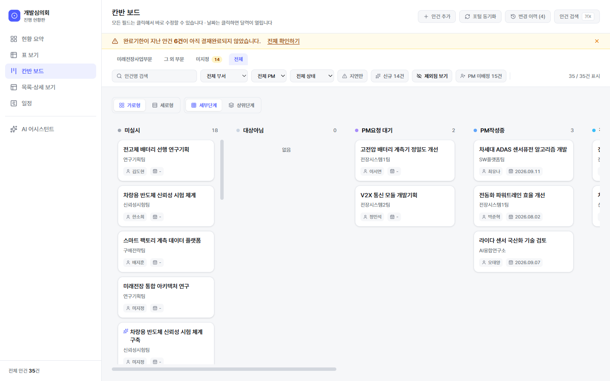

- ✨ — 카드 안건명 앞에 붙어 다른 카드와 바로 구분됩니다.

---

## 5. 일정

완료기한(최종납기) 기준으로 언제 무엇이 몰려있는지 봅니다. **타임라인**은 안건을 가로 막대로, **달력**은 날짜별로 보여줍니다.

| 타임라인 | 달력 |
|---|---|
| 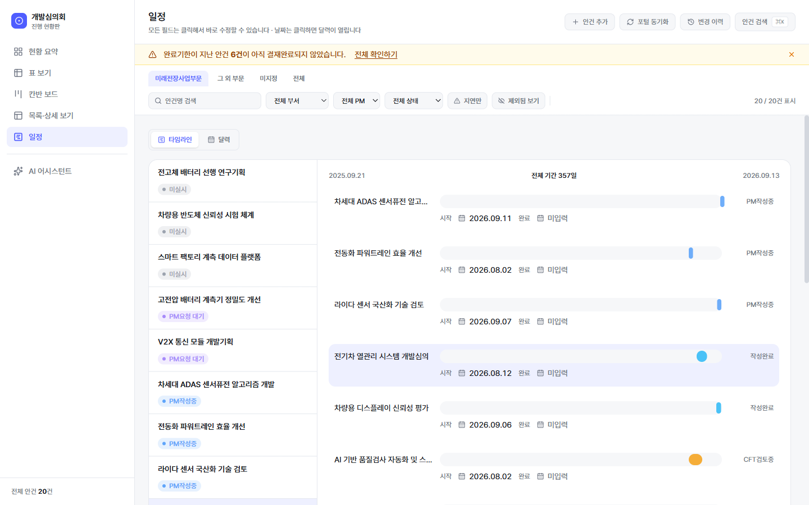 | 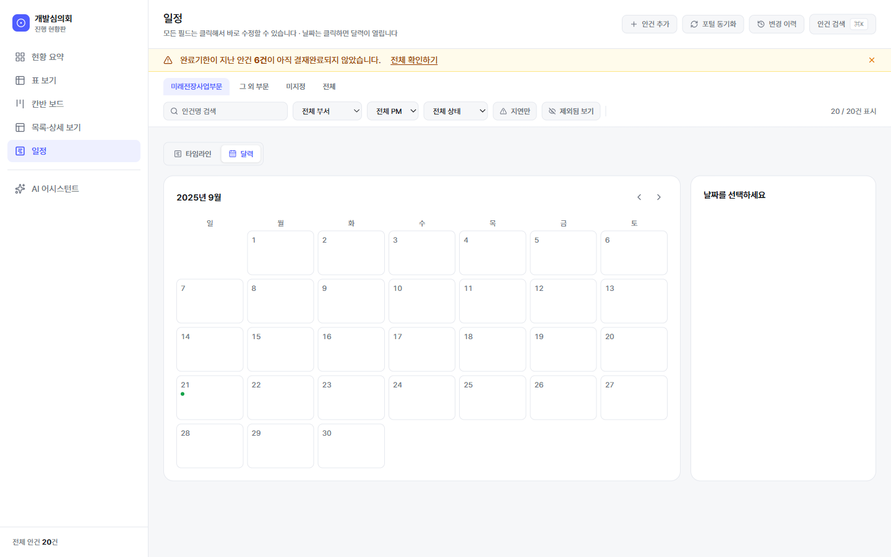 |

- 타임라인 — 안건을 가로 막대로 / 달력 — 날짜별로

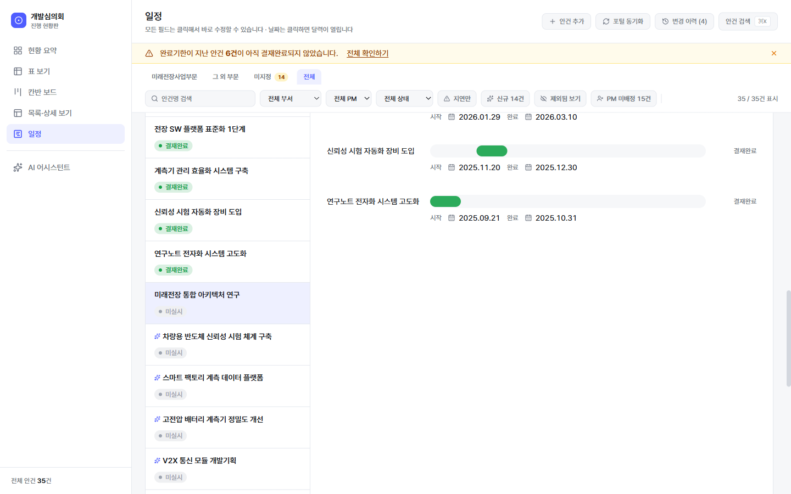

왼쪽 목록에도 ✨가 똑같이 표시됩니다. 아직 날짜가 없는 신규 안건은 오른쪽 막대그래프에는 안 나타나고 왼쪽 목록에서만 보입니다.

---

## 6. AI 어시스턴트

지금 필터로 걸러진 안건 데이터만 근거로 답하는 질의응답 화면입니다. 예: "지연되고 있는 안건 중 PM이 안 정해진 게 뭐야?" AI 모델은 Gemini(외부)·사내 Gemma·사내 Qwen 중 골라 쓸 수 있습니다.

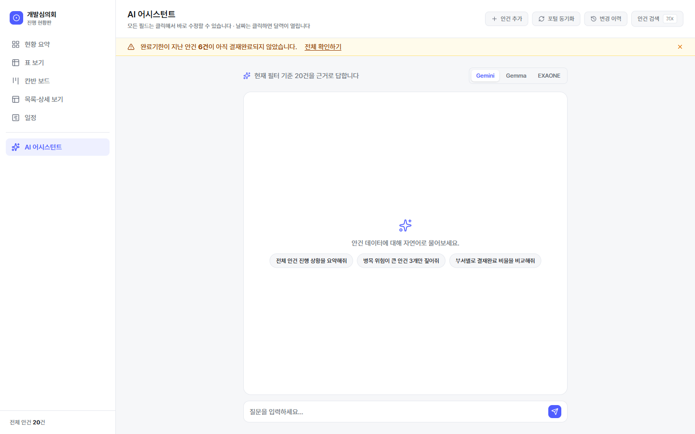

- 모델 선택 — Gemini / 사내 Gemma / 사내 Qwen
- 질문 입력창

화면에 보이는 안건 범위 밖의 내용은 답하지 않습니다 — 필터를 넓혀야 더 많은 데이터를 참고합니다.

---

## 7. 안건 수동 추가

포털에 없는 안건(예: 급하게 잡힌 내부 검토 건)을 직접 만들 때 씁니다. 헤더의 **+ 안건 추가** 버튼을 누르면 됩니다.

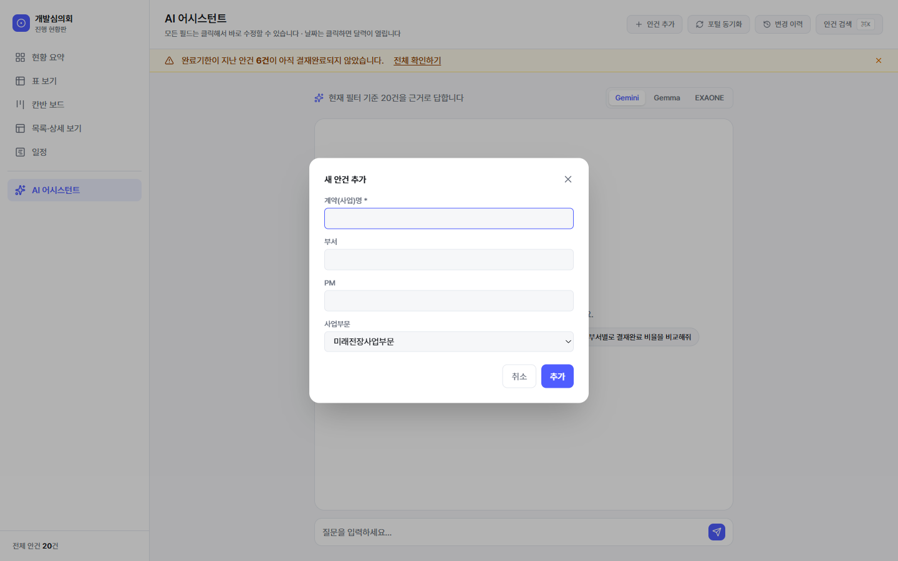

- 계약(사업)명 — 필수 입력
- BM 이름 / BM 부서 — 사업 담당자와 그 부서
- PM / PM 부서 — 실제 진행을 맡는 PM과 그 부서 (BM과 다를 수 있어 따로 입력)
- 사업부문 — 기본값은 우리 부문
- 사업형태 — 무기체계/핵심기술 등 9종 중 선택 (선택하면 금액과 함께 [10. 사업형태 및 1차 분류](#10-사업형태-및-1차-분류) 추천이 바로 계산됩니다)
- 계약금액(백만원) — 사업형태와 함께 1차 분류 판정에 쓰입니다
- 추가 — 저장하고 바로 상세 화면으로

만들고 나면 바로 상세 화면이 열려 이어서 진행 단계를 입력할 수 있습니다. 사업형태와 금액을 둘 다 입력했다면 생성 직후부터 1차 분류 추천이 떠 있습니다 — 안 넣었으면 나중에 상세 화면에서 채워도 똑같이 계산됩니다. 심의방법은 새로 만든 안건이든 포털로 새로 들어온 안건이든 항상 **"미지정"**으로 시작합니다 — 아직 아무것도 안 정해졌다는 뜻이며, 상세 화면에서 직접 고르거나 1차 분류를 확정하면 바뀝니다.

---

## 8. 포털 데이터 업로드 (가장 중요)

사업포털에서 받은 엑셀을 그대로 업로드하면, 기존 데이터와 자동으로 병합합니다. 서버에 파일을 미리 가져다 둘 필요 없이, 다운로드한 파일을 그 자리에서 선택하면 됩니다.

헤더의 **포털 데이터 업로드** 버튼을 누르면 **사업 / 국책사업** 선택지가 뜹니다. 평소 업무의 대부분은 **사업**이고, 국책사업은 [여기(국책사업 업로드)](#국책사업-업로드)에서 따로 설명합니다.

> ⚠️ **처음 도입해서 처음으로 동기화하는 경우**라면, 포털 엑셀에 있는 사업 전부가 — 몇백 건이더라도 — **한꺼번에 "신규"로** 뜹니다. 지금까지 이 도구로 아무것도 관리한 적이 없으니 시스템 입장에서는 전부 처음 보는 사업이기 때문이고, **버그가 아니라 정상 동작**입니다. 하나씩 열어보지 말고 바로 [9. 사업부문 분류](#9-사업부문-분류)의 일괄 처리로 넘어가세요. 두 번째 동기화부터는 진짜 신규 사업만 몇 건씩 뜨는 평소 화면이 됩니다.

### 평소 동기화 흐름 (두 번째 동기화부터)

1. 사업포털에서 사업/계약 현황 엑셀을 다운로드합니다.
2. 헤더의 **포털 데이터 업로드** 버튼을 클릭하고 **사업**을 선택합니다.
3. 방금 받은 엑셀 파일을 선택합니다.
4. 몇 초 후 **"신규 N건 · 갱신 N건 · 제외 N건"** 토스트가 뜨고, 화면이 자동으로 "신규만 보기" 상태로 전환됩니다.

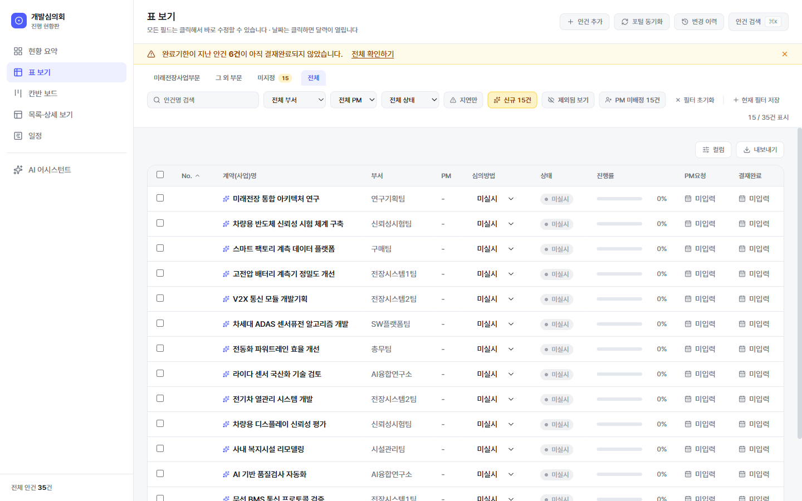

- 미지정 15 — 아직 분류 안 된 안건 수
- 신규 15건 — 동기화 직후 자동 켜지는 필터
- PM 미배정 15건 — PM이 비어있는 안건만

동기화 직후: 새로 들어온 15건이 "신규 15건" 필터로 자동 노출되고, 그중 PM이 비어있는 건수도 함께 표시됩니다.

### 동기화가 하는 일 (병합 규칙)

| 상황 | 결과 |
|---|---|
| 계약번호가 처음 등장 | 신규 안건으로 추가, 사업부문은 **미지정** 상태로 시작 |
| 기존 계약번호 + 포털 값이 바뀜 | 계약명·금액·부서 등 **포털 항목만** 갱신 |
| 기존 계약번호 + 이번 파일에 없음 | 화면에서 자동으로 **제외** 처리 (완전 삭제 아님, [13.](#13-안건-삭제--포털-제외-복원) 방법으로 복원 가능 — 사람이 직접 누르는 "완전 삭제"와는 다른 동작입니다) |
| PM·심의방법·비고 등 팀 입력값 | 동기화가 **절대 건드리지 않음** — 몇 번을 다시 동기화해도 유지 |

> ✅ 즉, PM 배정이나 사업부문 분류를 한 번 해두면 그다음 동기화부터는 **진짜로 새로 생긴 사업만** "신규"로 뜹니다. 매번 처음부터 다시 정리할 필요가 없습니다.

### 국책사업 업로드

"국책사업"은 포털에서 **별도 양식**으로 다운로드됩니다 — 일반 사업과 달리 계약번호가 없고 대신 **내부관리번호**가 키입니다. 그래서 업로드 경로도 따로 있습니다.

1. 포털에서 **국책사업** 목록 엑셀을 다운로드합니다.
2. 헤더의 **포털 데이터 업로드** 버튼을 클릭하고 **국책사업**을 선택합니다.
3. 방금 받은 엑셀 파일을 선택합니다.
4. **"국책사업 신규 N건 · 갱신 N건 · 제외 N건"** 토스트가 뜹니다.

**사업 업로드와 다른 점**:

| 항목 | 사업 | 국책사업 |
|---|---|---|
| 매칭 키 | 계약번호 | 내부관리번호 |
| 심의방법 자동 추천 | 사업형태·금액 기준으로 계산 | 안 함 — **항상 서면보고**(구 "전자결재")로 고정 |
| 목록 표시 | 일반 행 | 계약명 앞에 **"국책사업"** 배지 표시 |
| 협약금액 | 금액 1개 | 정부출연금·민간부담금(현금/현물/합계)·사업비합계 5개 항목 모두 보존 |

사업 업로드와 국책사업 업로드는 서로 **완전히 독립적**으로 동작합니다 — 국책사업을 올려도 기존 일반 사업이 "제외"되지 않고, 반대로 사업을 동기화해도 이미 올라간 국책사업 건은 그대로 유지됩니다.

---

## 9. 사업부문 분류

포털은 회사의 모든 사업을 다 보여주지만, 실제로 관리할 건 우리 부문 사업뿐입니다. 동기화로 새로 들어온 안건은 전부 **미지정** 상태로 시작하니, 이걸 하나씩(또는 한꺼번에) 분류해야 합니다.

| 분류값 | 의미 |
|---|---|
| 미래전장사업부문 | 우리 부문 사업 — 계속 관리 |
| C5ISR / 미사일시스템사업부문 | 다른 실제 사업부문 — "그 외 부문" 탭에서 확인 가능 |
| 해당없음 | 우리가 관리할 필요 없음 (타부서 사업, 이미 끝난 옛 사업 등) |

### 한꺼번에 정리하는 법 (처음 도입 시 필수)

표 보기에서 체크박스로 여러 개를 골라 **사업부문 일괄 지정 → 해당없음**으로 한 번에 처리하세요. 팀이 지정한 값이라 재동기화해도 유지되므로 **한 번만** 하면 됩니다.

정리 순서:
1. 부서 필터로 우리 부문과 무관한 부서(총무팀·인사팀 등)를 걸러 체크 → 일괄 "해당없음" 처리
2. 남은 것 중 이미 끝난 옛 사업들을 계약명·최종납기로 찾아서 마저 "해당없음" 처리
3. "미지정"에 남은 것들만 진짜 신규 사업 → "미래전장사업부문"으로 지정하고 PM 배정 시작

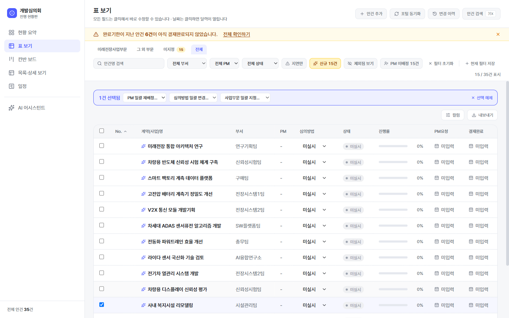

- 이 드롭다운("사업부문 일괄 지정…")에서 "해당없음"을 고르면 선택된 건 전체에 즉시 적용

---

## 10. 사업형태 및 1차 분류

포털에서 받은 "사업형태"(무기체계/핵심기술 등)와 계약금액을 기준으로, 심의방법(서면보고/대면보고)을 자동으로 추천해주는 기능입니다. 안건 상세 팝업(표 보기·현황 요약 등에서 행을 클릭하면 뜨는 창)에서 확인·조작합니다 — "목록·상세 보기" 화면에는 이 기능이 없습니다, 표 보기 등에서 팝업으로 열어야 합니다.

> ⚠️ **대면보고는 결재권자가 둘로 갈립니다**: 손충금 사업으로 체크하면 **대면보고(부문장)**, 그 외(아래 표의 금액 기준 충족)는 **대면보고(연구개발본부장)**입니다. 심의방법 선택지 자체가 이 둘로 나뉘어 있습니다.

| 사업형태 | 금액 기준 | 추천 결과 |
|---|---|---|
| 연구개발(무기체계) | 300억원 이상 | 대면보고(연구개발본부장) |
| 연구개발(핵심기술) | 150억원 이상 | 대면보고(연구개발본부장) |
| 그 외 모든 사업형태·금액 | — | 서면보고 (기본값) |

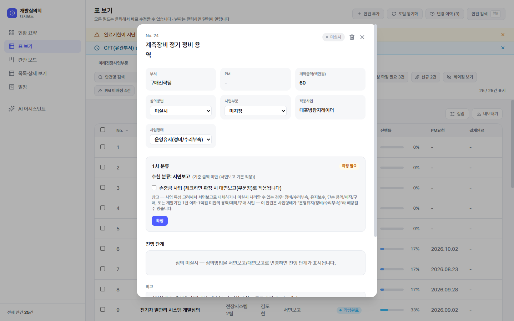

- 사업형태 — 9종(사업기타/양산(국내)/양산(해외)/연구개발(무기체계)/연구개발(민수)/연구개발(신속시범사업)/연구개발(해외)/연구개발(핵심기술)/운영유지(정비/수리부속)) 중 선택
- 추천 분류 — 사업형태 + 금액으로 자동 계산된 결과와 근거 문구. 항상 "대면보고(연구개발본부장)" 또는 "서면보고" 기준으로 계산되고, 손충금 여부는 추천값 자체에 반영되지 않습니다.
- 손충금 사업 체크 — 체크하면 "확정"을 누를 때 추천값과 무관하게 무조건 **대면보고(부문장)**로 적용
- 확정 — 아직 심의방법을 따로 안 건드렸으면(미실시 그대로) 추천값(또는 손충금 체크 시 대면보고(부문장))을 그대로 적용하고 "확정됨"으로 표시. 이미 수동으로 다른 심의방법을 골라놨다면 그 선택은 존중하고 확정 표시만 됩니다.

사업형태나 계약금액을 나중에 고치면 추천 분류가 그 즉시 다시 계산되고, "확정됨" 상태도 자동으로 "확정 필요"로 풀립니다 — 근거가 바뀌었으니 다시 한번 확인하라는 뜻입니다.

### 확정한 뒤 손충금 체크를 바꿨을 때 — 재적용

"확정"까지 �끝낸 안건이라도 손충금 체크 여부를 나중에 바꾸면, 지금 심의방법이 그 체크 상태와 안 맞게 될 수 있습니다. 이럴 땐 **재적용** 버튼이 다시 나타납니다.

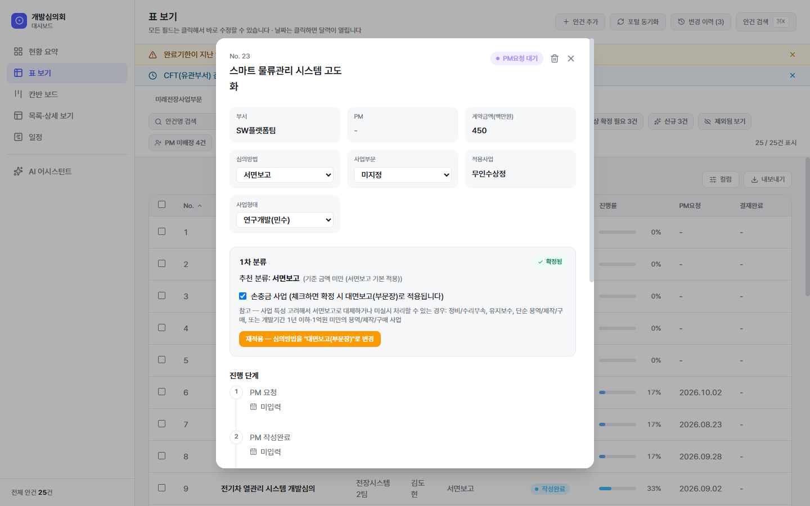

- 손충금 체크를 바꿨는데 현재 심의방법과 어긋나면, 버튼에 바뀔 값("대면보고(연구개발본부장)"로 변경 등)까지 미리 보여줍니다 — 체크를 끄면 원래 추천값으로, 체크를 켜면 "대면보고(부문장)"로 바뀝니다
- 눌러야만 실제로 심의방법에 반영됩니다 — 체크만 바꾼다고 자동으로 심의방법까지 바뀌지는 않습니다

> 💡 참고 문구(정비/수리부속, 유지보수, 단순 용역/제작/구매, 1년 이하·1억원 미만 용역 등)는 자동으로 적용되지 않습니다 — 담당자가 보고 판단하라는 참고용입니다.

---

## 11. 필터 활용

화면 위쪽 필터 바는 모든 화면에서 공통으로 적용됩니다 (AI 어시스턴트 제외).

| 필터 | 용도 |
|---|---|
| 부문 탭 | 미래전장사업부문 / 그 외 부문 / 미지정 / 전체 — 여기서 **"미지정"은 사업부문이 아직 안 정해진 것** ([9. 사업부문 분류](#9-사업부문-분류) 참고) |
| 전체 부서 ▾ | 특정 부서 안건만 보기 |
| 전체 PM ▾ | 특정 PM이 맡은 안건만 보기 |
| 전체 상태 ▾ | 특정 진행 단계(예: CFT검토중)의 안건만 보기. 목록 맨 위 **"미지정"은 사업형태와는 다른 개념으로, 심의방법이 아직 안 정해진 것**입니다 ([10. 사업형태 및 1차 분류](#10-사업형태-및-1차-분류) 참고) — 부문 탭의 "미지정"과 이름은 같지만 서로 다른 필터이니 헷갈리지 않도록 주의하세요. |
| 지연만 | 완료기한이 지났는데 아직 결재완료 안 된 안건만 |
| 신규 N건 | 포털 동기화로 새로 들어왔고 아직 한 번도 안 열어본 안건만 |
| PM 미배정 N건 | PM이 비어있는 안건만 — 신규 항목 배정 누락 확인용 |
| 제외됨 보기 | 제외 처리된(숨겨진) 안건까지 같이 표시 |
| 필터 초기화 | 지금까지 켠 필터를 한 번에 전부 해제 (부문 탭·제외됨 보기는 그대로 유지) |
| 현재 필터 저장 | 자주 쓰는 조합을 이름 붙여 저장 — 저장하면 이름표(칩)로 나타나고, 클릭하면 그 조합이 그대로 다시 적용됨 |

> 💡 여러 필터는 동시에 겹쳐 적용됩니다. 예: "미래전장사업부문" + "지연만"을 함께 켜면 우리 부문에서 지연된 것만 남습니다.

---

## 12. 변경 이력 · 되돌리기

헤더의 **변경 이력**을 열면 모든 필드 수정과 포털 동기화 요약이 시간순으로 쌓여있습니다. 실수로 잘못 고쳤을 땐 항목 옆 **"이 변경 되돌리기"**를 누르면 바로 이전 값으로 복구됩니다.

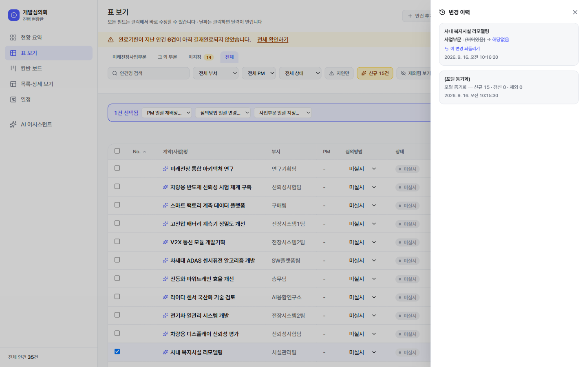

- 이 변경 되돌리기 — 클릭 한 번으로 이전 값 복구
- 포털 동기화 요약 로그 — 신규·갱신·제외 건수

포털 동기화 결과도 "(포털 동기화) 신규 15 · 갱신 0 · 제외 0" 형태로 한 줄 기록됩니다.

---

## 13. 안건 삭제 · 포털 제외 복원

### 안건 삭제 (완전 삭제, 복원 불가)

> ⚠️ 사람이 직접 지우는 삭제는 **완전 삭제**입니다. 제외 처리가 아니라 데이터 자체가 지워지며, 되돌릴 방법이 없습니다.

- 상세 팝업 우측 상단 **휴지통 아이콘** → "완전히 삭제할까요? 되돌릴 수 없습니다." 확인 팝업에서 승인
- 표 보기에서는 체크박스로 여러 건을 고른 뒤 선택 툴바의 **선택 삭제**로 한 번에 삭제 ([2. 표 보기](#2-표-보기) 참고)

잘못 지운 걸 되살리는 방법은 없으니, 확실하지 않으면 지우기 전에 한 번 더 확인하세요. 변경 이력에는 "안건 삭제됨" 기록이 남지만, 기록만 남을 뿐 데이터를 복구해주지는 않습니다.

### 포털 제외 · 복원 (자동, 복원 가능)

이건 사람이 지우는 것과 **다른** 동작입니다. 포털을 재동기화했는데 어떤 계약번호가 이번 파일에 없으면, 시스템이 그 안건을 자동으로 "제외" 상태로 숨깁니다 — 데이터는 그대로 남아있고 복원할 수 있습니다.

1. 기본 화면에서는 더 이상 안 보임 (필터의 **제외됨 보기**를 켜면 다시 보임)
2. 제외된 안건을 열면 노란 배너와 **복원하기** 버튼이 뜸 → 누르면 원상복구

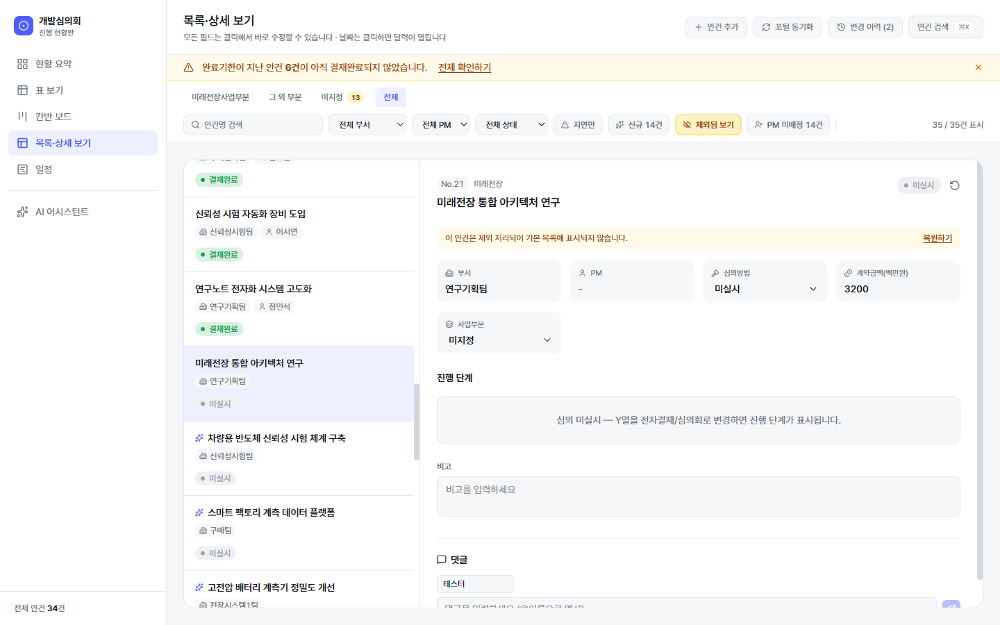

---

## 14. 엑셀 내보내기

표 보기 화면 우측 상단 **내보내기** 버튼을 누르면, **지금 필터로 걸러진 안건만** 엑셀 파일로 저장됩니다. 보고용으로 특정 부문·특정 PM만 뽑아서 내보낼 때 필터를 먼저 걸고 누르면 됩니다.

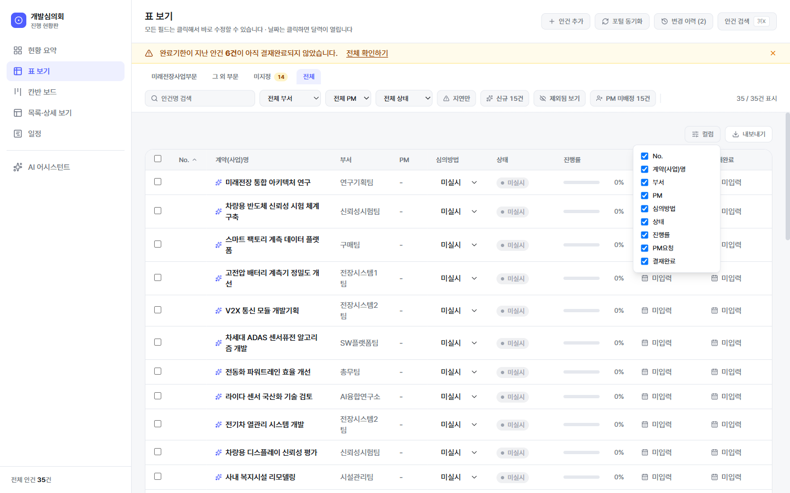

- 컬럼 — 체크된 열만 표 화면에 표시 (내보내기 결과에는 영향 없음)
- 내보내기 — 지금 필터 결과를 엑셀로 저장

**컬럼**은 화면 표시만 바꿉니다. 내보내기 파일에는 컬럼에서 숨긴 열과 상관없이 사업부문·BM 이름·BM 부서·PM·PM 부서·금액·진행 단계 등 항목이 항상 전부 포함됩니다 — 대신 **지금 걸어둔 필터는 그대로 반영**됩니다.

---

## 15. 데이터는 어디에 있나

이 앱은 별도 데이터베이스 없이, 서버 폴더의 JSON 파일 3개에 모든 내용을 저장합니다.

| 파일 | 내용 |
|---|---|
| `data/projects.json` | 모든 안건 데이터 (핵심) |
| `data/history.json` | 변경 이력 로그 |
| `data/comments.json` | 댓글 |

> ⚠️ **백업 필수**: 이 `data` 폴더가 유일한 원본입니다. 자동 백업은 없으니, 주기적으로 폴더 전체를 다른 곳에 복사해두는 걸 권장합니다.

---

## 16. 자주 묻는 상황

**Q. 포털 파일을 다시 올렸는데 내가 입력한 PM·비고가 사라질까 걱정돼요.**
사라지지 않습니다. 동기화는 포털이 주는 항목(계약명·부서·금액·기관 등)만 갱신하고, PM·심의방법·비고·사업부문처럼 팀이 직접 입력하는 항목은 절대 건드리지 않습니다.

**Q. 실수로 계약금액을 이상한 값으로 입력했어요.**
숫자가 아닌 값을 넣으면 저장 자체가 거부되고 화면에 안내 메시지가 뜹니다 — 예전 값이 실수로 0이 되는 일은 없습니다.

**Q. 옛날에 끝난 사업들이 "미지정"에 계속 쌓여서 지저분해요.**
[9. 사업부문 분류](#9-사업부문-분류)에서 설명한 대로, 표 보기에서 체크박스로 한꺼번에 골라 "해당없음"으로 일괄 처리하세요. 한 번만 해두면 다음 동기화부터는 다시 안 나타납니다.

**Q. 손충금 체크는 새로 만든 안건에서만 되나요?**
아니요. 새 안건이든 기존 안건이든 상관없이, **사업형태와 계약금액이 지정되어 있는 안건이면** 상세 팝업에 1차 분류 카드(손충금 체크 포함)가 똑같이 뜹니다. 다만 "목록·상세 보기" 화면(팝업이 아닌, 왼쪽 목록+오른쪽 상세로 된 화면)에는 이 기능이 없으니, 표 보기나 현황 요약에서 안건을 클릭해 팝업으로 열어야 합니다. 자세한 내용은 [10. 사업형태 및 1차 분류](#10-사업형태-및-1차-분류) 참고.

**Q. 안건을 지웠는데 다시 살릴 수 있나요?**
아니요. 휴지통 아이콘이나 "선택 삭제"로 지운 안건은 **완전 삭제**라 복원할 수 없습니다. 반면 포털 재동기화로 자동 숨겨진("제외") 안건은 복원 가능합니다 — 둘은 다른 동작입니다. 자세한 건 [13. 안건 삭제 · 포털 제외 복원](#13-안건-삭제--포털-제외-복원) 참고.

**Q. 여러 명이 동시에 써도 되나요?**
지금 구조는 1인 사용을 전제로 만들어졌습니다. 여러 명이 같은 안건을 동시에 고치면 나중에 저장한 값이 이전 값을 덮어씁니다.

**Q. 서버를 껐다 켜면 데이터가 초기화되나요?**
아니요. `data/` 폴더 파일이 남아있는 한 그대로 유지됩니다. 이 파일들이 지워지거나 손상된 경우에만 서버가 안전을 위해 시작을 거부합니다 (조용히 더미데이터로 덮어쓰지 않습니다).

---

## 17. 레거시 데이터(구 엑셀) 업로드

이 대시보드를 쓰기 전에 엑셀로 관리하던 안건(PM, 위원장, 심의결과, CFT 부서별 진행 날짜 등)을 옮겨올 때 씁니다. 헤더의 **레거시 데이터 업로드** 버튼을 누르면 됩니다.

> ⚠️ **포털 데이터 업로드(사업)와 정반대로 동작합니다.** 그쪽은 계약명·금액 같은 포털 항목만 갱신하고 PM·심의방법 같은 팀 입력값은 절대 안 건드리는데, 이 기능은 **그 반대** — PM·위원장·심의방법·CFT 진행 날짜 같은 팀 입력값만 채우고, 계약명·금액 같은 포털 항목은 절대 건드리지 않습니다. 그래서 구 엑셀을 포털 데이터 업로드 버튼에 올리면 안 되고, 반드시 이 버튼을 써야 합니다.

**준비할 것**: 구 엑셀(안건 관리 시트)에 **"계약번호" 열을 직접 추가**해서, 각 행에 해당 사업의 포털 계약번호를 적어 넣습니다. 계약번호를 모르면 비워둬도 되지만, 그러면 기존 안건과 매칭되지 않고 새 안건으로 따로 생성됩니다.

1. 구 엑셀에 "계약번호" 열을 추가하고 값을 채웁니다.
2. 헤더의 **레거시 데이터 업로드** 버튼을 클릭해 파일을 선택합니다.
3. 몇 초 후 **"갱신 N건 · 신규생성 N건"** (인식 못 한 심의방법 값이 있으면 "확인필요 N건"도 같이) 토스트가 뜹니다.

**계약번호가 일치하면**: 기존 안건의 PM/위원장/심의방법/CFT 날짜 등만 채워 넣습니다 (사업형태·금액 같은 포털 항목은 그대로 유지).
**계약번호가 없거나 일치하는 안건이 없으면**: 독립된 새 안건으로 만듭니다. 이 경우 "확정 필요" 목록에 뜨고, 비고 맨 앞에 `[이관-미매칭, 수동확인 필요]`가 붙어 나중에 찾아보기 쉽습니다.

> 💡 심의방법의 옛 값 "심의회"는 지금의 대면보고(부문장)/대면보고(연구개발본부장) 구분이 생기기 전 용어라, 같은 행의 "위원장" 값으로 자동 구분합니다 (부문장 → 대면보고(부문장), 대표이사·본부장 → 대면보고(연구개발본부장)). 위원장 텍스트로도 판단이 안 되면 심의방법을 비워두고 "확인필요" 건수에 포함시킵니다 — 상세 화면에서 직접 지정해주세요.

업로드할 때마다 서버가 `data/` 폴더를 자동 백업해두므로, 잘못 올렸다면 [12. 변경 이력 · 되돌리기](#12-변경-이력--되돌리기)에서 항목별로 되돌리거나 백업 폴더에서 복구하면 됩니다.

---

*개발심의회 대시보드 내부 사용 매뉴얼 · 스크린샷은 데모용 더미 데이터 기준입니다.*
